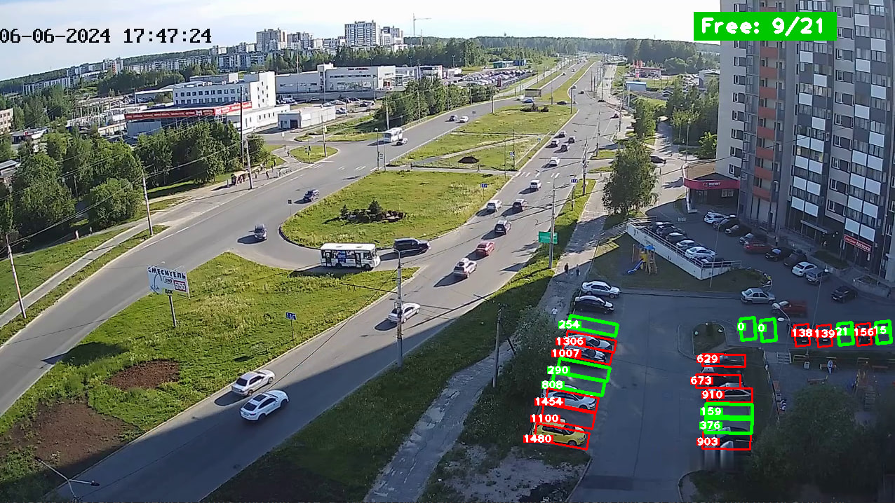
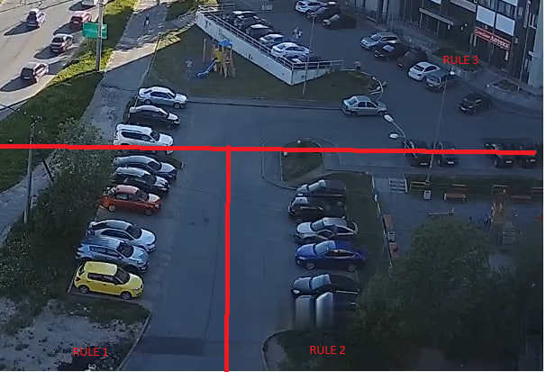

<div align="center">

<h1>
  <br>
  🅿🅰🆁🅺🅸🅽🅶 🅳🅴🆃🅴🅲🆃🅾🆁
  <br>
</h1>

<h3>Free parking-space counter with classical image processing</h3>

<p><i>No neural networks: adaptive thresholding and pixel counting inside hand-marked,<br>perspective-corrected parking spaces.</i></p>

<p>
  
  
  
  
</p>

<p>
  <a href="#tldr">TL;DR</a> •
  <a href="#quickstart">Quickstart</a> •
  <a href="#how-it-works">How it works</a> •
  <a href="#tech-stack">Tech stack</a>
</p>

</div>

---

<div align="center">
  
  <br><sub><i>Free spaces in green, occupied in red, the pixel count inside each space and the running "Free: N/M" counter.</i></sub>
</div>

---

<a id="tldr"></a>
## 🚀 TL;DR

Two small OpenCV tools:

- **`ParkingPlacePicker.py`** – mark every parking space once on a reference photo. Spaces are drawn as rotated, scaled rectangles so they follow the perspective of each part of the lot.
- **`ParkingLotLocator.py`** – process the parking video frame by frame and decide for every marked space whether it is free, by counting edge pixels inside it.

---

<a id="quickstart"></a>
## ⚡ Quickstart

```bash
git clone https://github.com/PavelLekomtsev/parking-detector.git
cd parking-detector
pip install -r requirements.txt
```

**1. Mark the spaces** on `materials/ParkPhoto.png`:

```bash
python ParkingPlacePicker.py
```

Left click adds a space at the cursor, right click removes it, `r` closes the window. Positions are saved to `materials/CarParkPositions` – a ready-made layout for the sample photo is already in the repo.

**2. Count free spaces** on a video of the same lot. The video is not stored in the repository: put your own recording at `materials/ParkVideo.mp4`, then run

```bash
python ParkingLotLocator.py
```

`r` closes the window.

---

<a id="how-it-works"></a>
## 🧭 How it works

1. **Marking.** The lot is split into three zones by fixed borders. Each zone has its own rule – rotation angle, scale and size offsets – so the marked rectangles match how spaces look from the camera (see `materials/Rules.jpg`).
2. **Preprocessing.** Every frame goes through grayscale → Gaussian blur → adaptive Gaussian threshold (inverted) → median blur → dilation. Cars become dense clusters of white pixels, empty asphalt stays mostly black.
3. **Decision.** Inside each space the non-zero pixels are counted with `cv2.countNonZero`. Below a per-zone threshold the space is free and outlined in green, otherwise it is occupied and outlined in red.
4. **Overlay.** The pixel count is printed on every space and the total `Free: N/M` is shown in the corner.

<div align="center">
  
</div>

---

<a id="tech-stack"></a>
## 🧰 Tech stack

| Area | Tools |
|---|---|
| Image processing | OpenCV: adaptive thresholding, blurs, morphology, affine rotation |
| Overlay | CVZone text boxes |
| Storage | pickled list of marked positions |
| Tests | pytest unit tests for the geometry and marking helpers in `tests/` |
